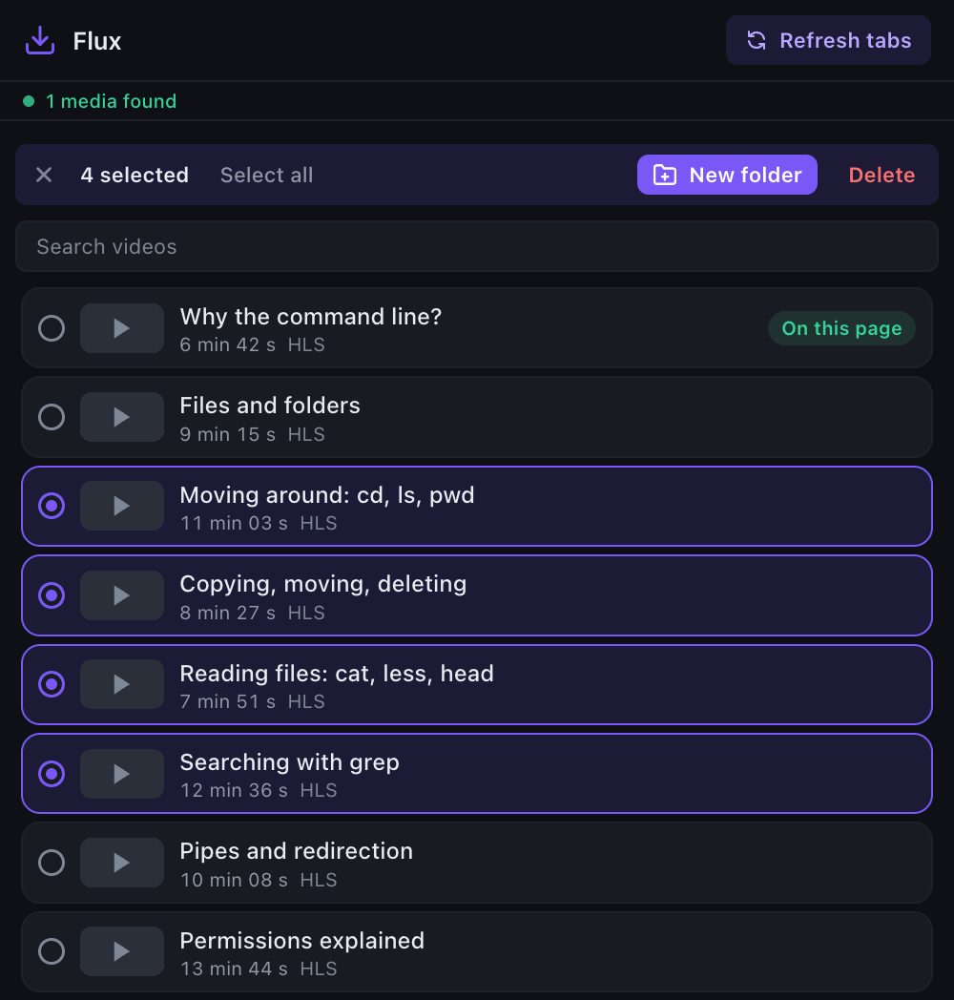
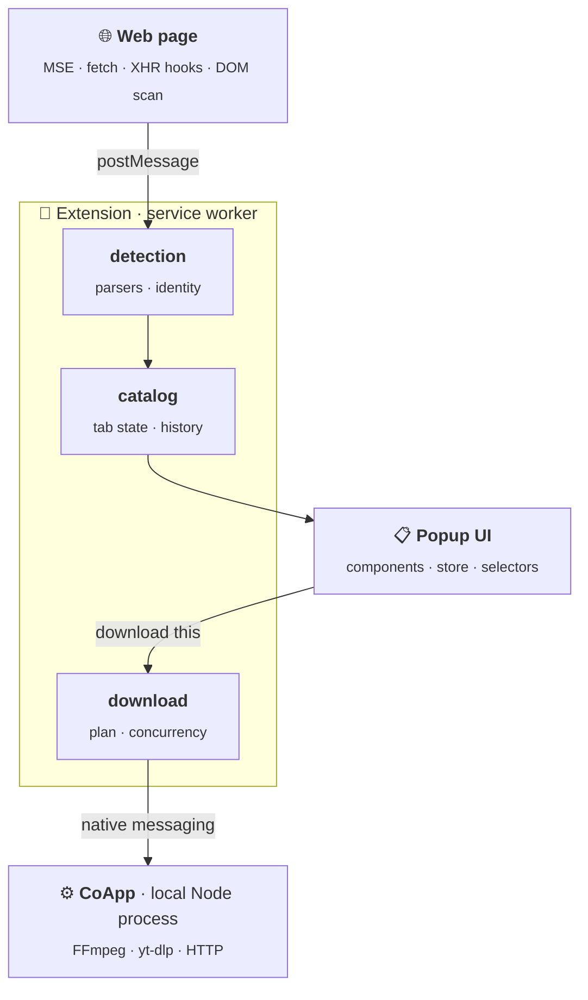

<p align="center">
  
</p>

<h1 align="center">Flux Downloader</h1>

<p align="center">
  Save the video your browser is already playing.<br>
  Free, open source, and nothing leaves your machine.
</p>

<p align="center">
  <a href="https://github.com/FernandoHN99/flux-downloader/actions/workflows/ci.yml"></a>
  <a href="https://github.com/FernandoHN99/flux-downloader/releases/latest"></a>
  
  
  
</p>

<p align="center">
  <a href="https://fernandohn99.github.io/flux-downloader/">Website and live demo</a> |
  <a href="docs/install.md">Install guide</a> |
  <a href="https://github.com/FernandoHN99/flux-downloader/releases/latest">Download</a> |
  <a href="CONTRIBUTING.md">Contribute</a>
</p>

<p align="center">
  
</p>

## What it does

Open a page with a video, play it, and click the Flux icon: the stream is in the list. Pick a quality and save it to your own disk.

A browser cannot write files or run FFmpeg, so Flux is two halves: a Manifest V3 extension that **finds** media, and a small local companion app that **saves** it. They talk over Chrome native messaging.

| | |
|---|---|
| **Finds** | HLS (`.m3u8`), DASH (`.mpd`), direct MP4 and WebM, `<video>` elements, and streams that only exist inside Media Source Extensions |
| **Understands** | Video, alternate audio and subtitle renditions, read from the manifest itself |
| **Saves** | FFmpeg stream copy for HLS and DASH, yt-dlp for YouTube, and up to eight parallel connections for direct files |
| **Organises** | One list across every tab, optional history, grouping by the real source site, your own folders, search, rename, reorder, and a batch download that runs four at a time |

Media playing right now is pinned above the rest. A video keeps the page that actually exposed it: a lesson stays under the course site's address even though its bytes come from a CDN.

**Shift-click** a row to select a run of videos, **Ctrl/Cmd-click** to pick single ones, then file them into a folder or remove them from the bar that appears. Try it on the [live demo](https://fernandohn99.github.io/flux-downloader/).

## Install

You install the companion app with a script, then load the extension from a folder. It is not on the Chrome Web Store, which does not allow downloaders; the full steps, with troubleshooting, are in the [install guide](docs/install.md).

**macOS and Linux.** You need [Node.js](https://nodejs.org) 18 or newer and FFmpeg. Download `flux-downloader-portable.tar.gz` from the [latest release](https://github.com/FernandoHN99/flux-downloader/releases/latest), then:

```bash
tar xzf flux-downloader-portable.tar.gz
cd flux-downloader-portable
./install.sh            # add --yt-dlp for YouTube
```

It needs no root, registers the companion with every Chromium-based browser it finds (Chrome, Chromium, Brave, Edge, Vivaldi), and tells you if something is missing and how to install it.

**Windows.** Run `FluxDownloader-Setup-win-x64.exe` from the [latest release](https://github.com/FernandoHN99/flux-downloader/releases/latest). It brings FFmpeg and yt-dlp and checks their hashes. Extract `FluxDownloader-extension.zip` somewhere permanent.

**Then load the extension.** Open `chrome://extensions`, turn on **Developer mode**, click **Load unpacked**, and choose the extension folder (the installer prints it). Open the extension's Settings to check that it can reach the companion app.

Every release file is listed with its SHA-256 in `SHA256SUMS.txt`.

### From source

```bash
git clone https://github.com/FernandoHN99/flux-downloader.git
cd flux-downloader
npm ci && npm run build
scripts/install.sh          # macOS and Linux; on Windows: coapp\scripts\register-dev-host.ps1
```

Then load the `extension/` folder as above (not `extension/dist/`).

## Good to know

- **No DRM.** Flux saves streams the page serves in the clear. It does not circumvent protection, and it will not.
- **Save what you may.** You are responsible for what you download. Keep to media you have the right to keep: your own, public domain or licensed, or what a site's terms allow.
- **Browsers.** Chrome, Edge, Brave, Chromium and Vivaldi on macOS and Linux; Chrome and Edge on Windows. No Firefox. A browser installed as a Snap or Flatpak is sandboxed and cannot start the companion app.
- **Privacy.** Everything stays on your machine. Settings and history use `chrome.storage.local`; the companion only talks to the extension that registered it. No analytics, no accounts, no servers. See [PRIVACY.md](docs/PRIVACY.md).

## How it works



Source is grouped by domain, and each folder carries its own `AGENTS.md`
explaining the rules that live there:

| Folder | Owns |
|---|---|
| [`entrypoints/`](extension/src/entrypoints) | Service worker, content script, MAIN-world hook |
| [`detection/`](extension/src/detection) | Page hooks, HLS/DASH parsers, media identity |
| [`catalog/`](extension/src/catalog) | Per-tab state, history and its persistence |
| [`download/`](extension/src/download) | Download plan, concurrency gate, native client |
| [`popup/`](extension/src/popup) | Component UI with its own store and selectors |
| [`coapp/src/`](coapp/src) | RPC, FFmpeg, yt-dlp, filesystem |

A few decisions worth calling out:

- **Media identity is a normalised key, not a URL.** Signed CDN links rotate
  their token on every visit, so matching raw strings would show one video
  twice.
- **The popup owns its own state, split from the background's.** A detection
  arriving mid-rename cannot wipe what you are typing.
- **One user-visible run is reserved synchronously** before the first `await` —
  disabling buttons is feedback, not the lock. A batch fans that lease out to
  four native jobs.
- **The MAIN-world hooks stay invisible.** Patched APIs report native source and
  keep the extension out of error stacks, because a player that notices
  tampering stops rendering.

## Develop

```bash
npm ci
npm test                  # extension and companion app, with Vitest
npm run build             # extension bundles, then the companion app
npm run dev:extension     # rebuild on change
npm run package:portable  # the macOS/Linux archive
npm run smoke:install     # install that archive in a throwaway HOME and start the host
npm run build:site        # the download page, with a live copy of the popup
```

No linter and no runtime dependencies: just TypeScript, esbuild and Vitest. CI runs the tests and the build on Linux, macOS and Windows, lints the shell scripts, and checks the installer end to end.

[AGENTS.md](AGENTS.md) is the guide to the code, for people as much as for agents: the rules it keeps, and the bugs those rules came from. [docs/](docs) goes deeper on [detection](docs/detection.md), [native messaging](docs/native-messaging.md), [the companion app](docs/coapp.md) and [releasing](docs/releasing.md).

## Contributing

Bug reports, fixes, docs and ideas are welcome: see [CONTRIBUTING.md](CONTRIBUTING.md). To report a vulnerability, see [SECURITY.md](SECURITY.md). If you are not sure something is a bug, start a [discussion](https://github.com/FernandoHN99/flux-downloader/discussions).

## Credits

Flux Downloader started from [miroshArtem/MediaGrabber](https://github.com/miroshArtem/MediaGrabber), by miroshArtem, and grew from there: the domain-grouped source layout, the component popup, the parser and lifecycle test suites, the macOS and Linux installer, and the detection and download fixes in the [changelog](docs/changelog.md). Still MIT, like the original, and the original copyright notice is kept in the [licence](LICENSE).

FFmpeg and yt-dlp do the actual saving and are separate programs with their own licences: see [THIRD_PARTY_NOTICES.md](THIRD_PARTY_NOTICES.md).

<p align="center"><sub><a href="LICENSE">MIT</a></sub></p>
